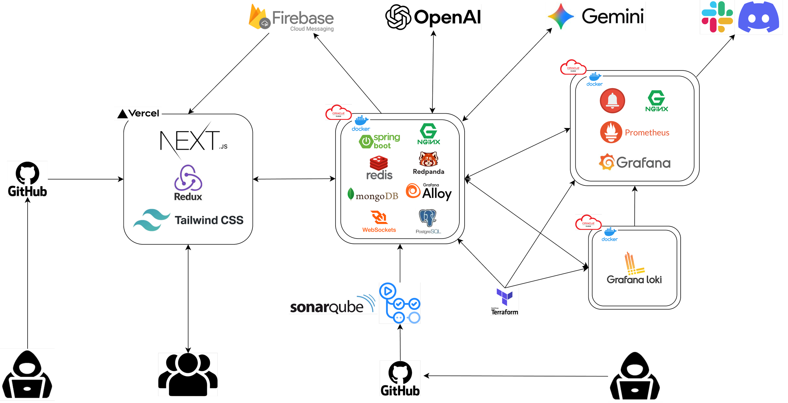

# Loopin Backend — 핵심 코드 발췌

AI 플래너로 루틴을 만들고, 팀 단위로 채팅·알림을 주고받는 루틴 관리 서비스 **Loopin**의 백엔드 중 제가 작성한 코드를 옮긴 레포입니다.

- **서비스**: [loopin.co.kr](https://loopin.co.kr) · [App Store](https://apps.apple.com/kr/app/%EB%A3%A8%ED%95%80/id6775146643)
- **원본**: 팀 레포 `ITA-Loopin/loopin-be`(비공개)의 발췌본입니다. 패키지 경로는 원본 그대로 두었고, 일부 파일만 옮겼기 때문에 이 레포만으로는 빌드·실행되지 않습니다.
- **팀**: 잇타(IT'S TIME) Backend 8기 7인 팀. 저는 백엔드 리드와 인프라를 맡았습니다.
- **기간**: 2025.09 ~ 2026.01 개발·배포, 이후 운영 중
- **스택**: Java 21, Spring Boot 3.5, Redpanda(Kafka), Redis, MongoDB, PostgreSQL, FCM, Spring AI(OpenAI·Gemini), Resilience4j, OCI, Terraform, Docker, Nginx, Prometheus·Grafana·Loki, K6

## 시스템 아키텍처

## 구성

`src/main/java/com/loopone/loopinbe/` 아래 경로입니다. 각 패키지의 테스트는 `src/test/java/` 같은 경로에 있습니다.

| 경로 | 내용 | 본인 작성 비율 |
| --- | --- | --- |
| `domain/account`, `global/oauth`, `global/security`, `global/web` | 회원·인증. Google·Naver·Kakao·Apple 소셜 로그인(계정 식별은 provider + providerId), JWT, Http-Only 쿠키(SameSite=Lax), 리프레시 토큰 | 96~100% |
| `domain/chat`, `global/webSocket` | 팀 채팅. WebSocket으로 받은 메시지를 Redpanda에 발행하고, 컨슈머가 MongoDB에 저장한 뒤 브로드캐스트. `clientMessageId` 기반 upsert로 재전달돼도 한 번만 저장하고, `chatRoomId`를 메시지 키로 써서 채팅방 단위 순서를 보장 | 83%, 98% |
| `global/kafka` | 채팅·푸시·알림·AI 플래너 이벤트의 발행과 소비. 처리 실패 시 1초 간격 3회 재시도 후 DLT로 이동 | 96% |
| `domain/fcm` | FCM 푸시. 처리 중 토큰을 `SETNX`로 잡고 Lua 스크립트로 토큰이 같을 때만 해제·완료 처리해, 같은 이벤트를 두 번 보내지 않음 | 94% |
| `domain/notification` | 알림 목록과 알림 설정 | 96% |
| `domain/loop/loopReport` | 루프 리포트. 7일·10일·이번 달 달성률, GOOD/OK/HARD 진단, '가장 잘한 루프'는 100% 달성 일수로 동률을 가름 | 97% |
| `global/alert`, `docker/oci/a1_flex/monitoring` | 앱 예외 실시간 알림(같은 예외는 쿨다운 동안 한 번만 Slack·Discord로 전송), Prometheus 알림 규칙 7개(인스턴스 다운, CPU·메모리·디스크, 컨테이너 재시작, 5xx 비율, p95 응답 시간), Loki | 100% |
| `global/initData` | 부하 테스트용 데이터 생성과 정리. VU 수만큼 회원·루프·팀·팀 루프를 만듦 | 93% |
| `terraform/oci/a1_flex`, `docker/oci/a1_flex`, `nginx`, `deploy.sh` | OCI A1.Flex 인프라와 배포. 헬스체크에 실패하면 직전 이미지로 되돌림 | 96~100% |
| `src/main/resources/application.excerpt.yml`, `src/test/.../domain/loop/ai` | AI 플래너의 LLM 재시도·HTTP 타임아웃·프로바이더별 서킷브레이커 설정(발췌)과, 재시도·429 차단·파싱 실패·서킷 예외 정책을 고정한 테스트 | 96% |
| `load-test/` | K6 부하 테스트(별도 레포 `ITA-Loopin/loopin-be-k6-test`, 전부 본인 작성). EC2 t3.micro, OCI E2.1.Micro, OCI A1.Flex 각각의 smoke·load·stress 시나리오, 결과 수집용 Prometheus·Grafana. `test-server-aws-t3-micro/`는 운영 서버와 같은 사양으로 띄운 테스트 서버의 Terraform과 배포 스크립트 | 83~100% |

## 부하 테스트 결과 (K6)

조회 API 5개(회원 정보, 루프 캘린더, 날짜별 루프 목록, 루프 상세, 루프 리포트)를 섞은 시나리오입니다.

| 서버 | 결과 |
| --- | --- |
| EC2 t3.micro (2 vCPU, 1GB) | VU 500에서 p95 62.61ms로 안정. VU 550부터 p95 2.09s, 에러 385건 → 처리 한계 VU 약 500 |
| OCI A1.Flex (4 OCPU) | VU 1,000·25분에서 p95 679.67ms, 에러 0건. 최대 응답이 3.57s까지 튀는 구간이 있어 안정 운영 구간을 VU 700~800으로 산정 |

## 작성 범위

- 패키지를 통째로 옮기되, 현재 코드 기준으로 줄의 과반을 제가 작성한 파일만 남겼습니다(`git blame` 기준). 옮긴 코드 줄의 93.8%가 제가 작성한 줄입니다. 원본 레포 전체로는 머지 커밋을 뺀 675개 중 542개가 제 커밋입니다.
- 팀원이 주로 작성한 파일은 뺐습니다. `domain/sse` 패키지, `chatRoom`의 컨트롤러·enum·일부 DTO, `MessageType`, `MessageContext`가 여기에 해당합니다.
- AI 플래너의 LLM 호출, SSE 전송, 서킷브레이커 첫 구현은 팀원이 맡았습니다. 저는 요청을 Kafka 이벤트로 넘기는 파이프라인과, 이후 재시도·폴백 정책 정리(중첩 재시도 제거, HTTP 타임아웃, 429를 서킷 집계에서 제외, 파싱 실패 재시도, 프로바이더별 차단, Gemini 최종 폴백)를 맡았습니다.
- 2026년 4월 이후 작업은 Claude Code·Codex 같은 AI 코딩 에이전트와 함께 했습니다. 재시도·폴백 정책 정리는 스펙에서 수용 기준 테스트를 먼저 만들어 동결한 뒤 구현하는 절차로 진행했습니다(테스트 Codex, 구현 Claude Code). 이 절차는 [claude-ops-harness](https://github.com/KooJunhwi/claude-ops-harness)에 정리해 두었고, Loopin 백엔드에서 수정·배포 시간을 API당 177분에서 11.1분으로 줄였습니다.
- 키·비밀번호 같은 비밀값은 모두 환경 변수로 주입되며, 이 레포에는 포함되어 있지 않습니다.
